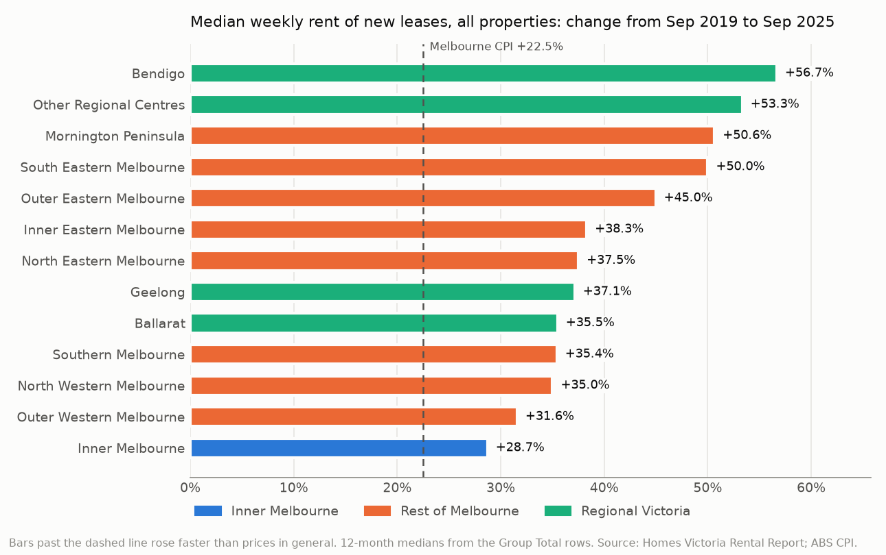
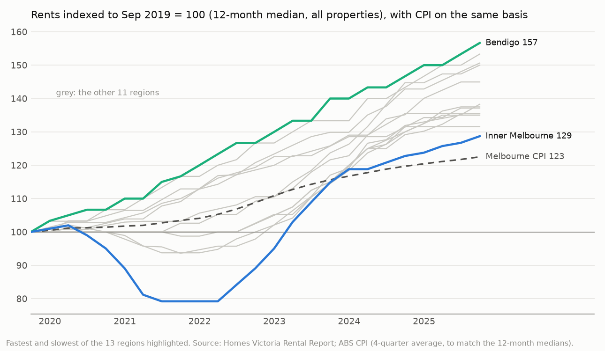
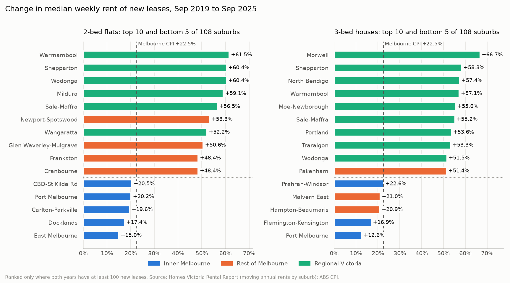
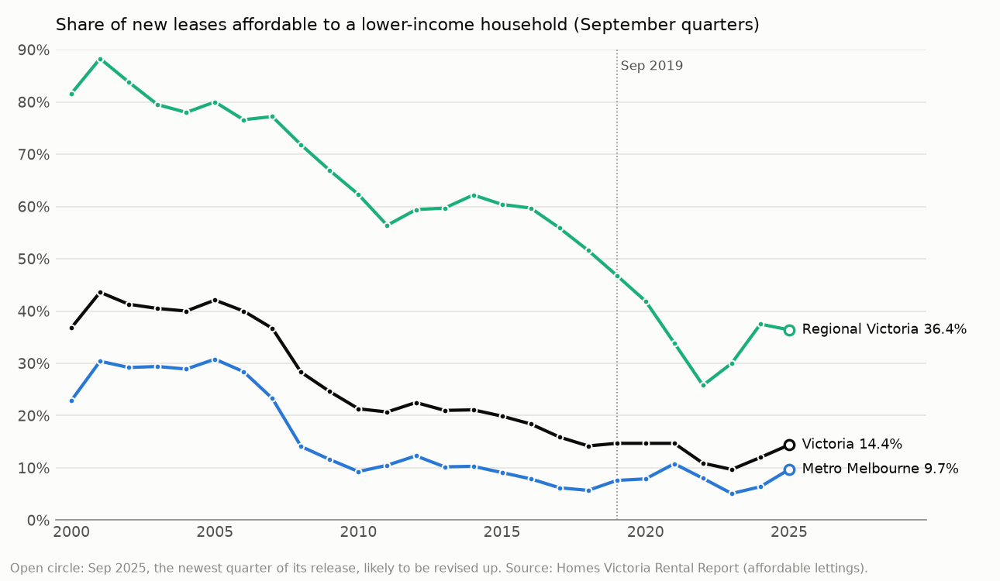
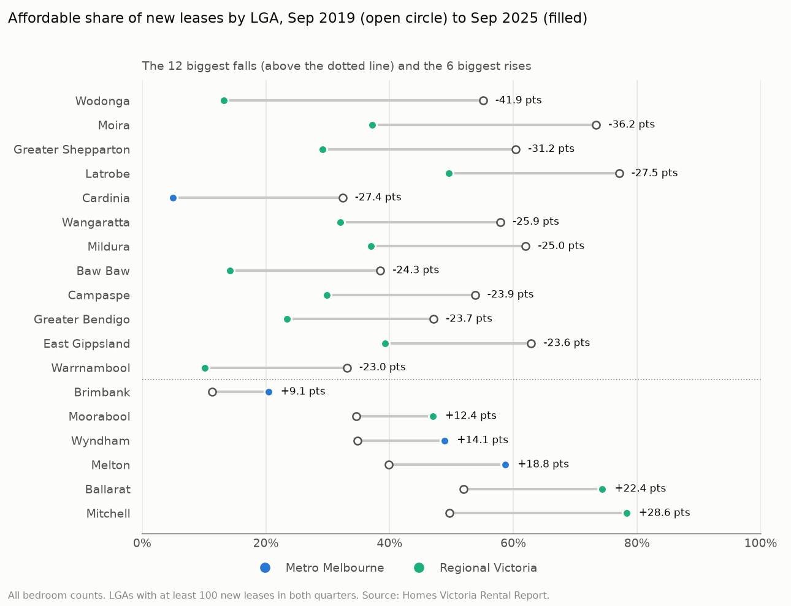
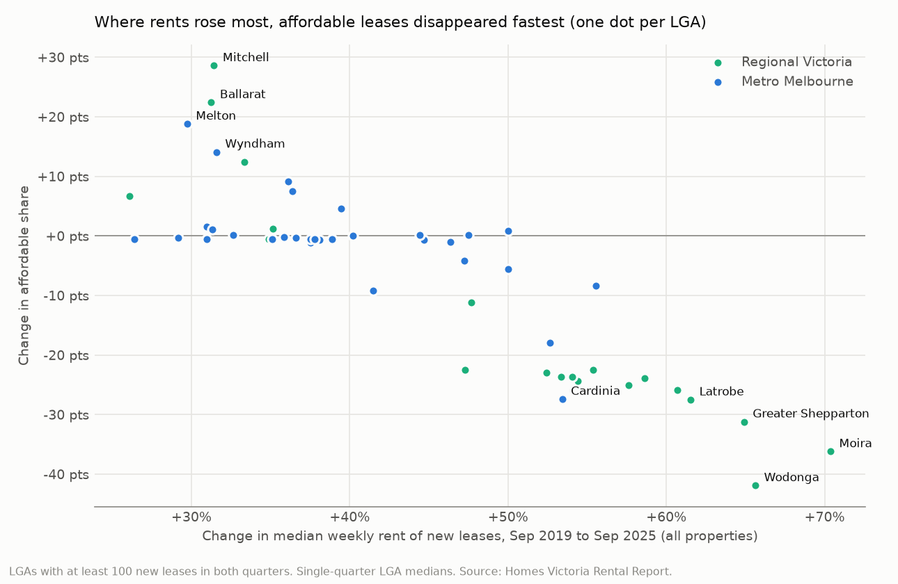

# Victorian Rental Market Analysis

> **Status: in progress. Parts 1–3 of 5 are done: the data audit, where rents are rising fastest, and affordability.** Market activity and the final write-up come next (see [Roadmap](#roadmap)).

**Business question:** rents in Victoria have climbed for years, but not evenly. **Where are rents rising fastest, where is it still affordable to rent, and how has that changed since before COVID?** The answer matters to anyone who prices, manages or plans rental housing:

- a **property manager or agency** setting rents and choosing which suburbs to grow its rent roll in,
- a **community housing provider or council** deciding where lower-income renters are being priced out,
- an **employer or university** advising staff and students on where they can afford to live (Melbourne is one of Australia's biggest international-student cities).

## Data

**Source:** Homes Victoria (Department of Families, Fairness and Housing), *Rental Report – Quarterly*, published on [DataVic](https://discover.data.vic.gov.au/) (search "Rental Report - Quarterly"). Licence: [CC BY 4.0](https://creativecommons.org/licenses/by/4.0/). The figures come from rental bonds lodged with the Residential Tenancies Bond Authority, so they cover new leases, not every rent being paid.

| Table | Grain | Coverage | Measures |
|---|---|---|---|
| Moving annual rents by suburb | 146 suburbs and towns (110 metro, 36 regional) × 7 dwelling types | Mar 2000 – Sep 2025, 103 quarters | median weekly rent and number of new leases in the 12 months to each quarter |
| Quarterly median rents by LGA | 79 Local Government Areas × 7 dwelling types | Jun 1999 – Sep 2025, 106 quarters | median weekly rent and number of new leases in that quarter |
| Affordable lettings by LGA | 79 LGAs × bedrooms (1–4, all) | Mar 2000 – Sep 2024, 99 quarters | new leases affordable to a lower-income household on Centrelink payments (rent ≤ 30% of gross income), count and share |
| Report tables, Sep 2025 | Tables 4, 9 and 14; Figure 8 source | Sep 2025 (Figure 8: Sep 2020 – Sep 2025) | Table 4 checks the parsed rents. Table 14 gives affordable lettings by LGA for Sep 2025, Table 9 the household and affordable rent for each bedroom count, Figure 8 a revised state / metro / regional series |
| ABS Consumer Price Index, Melbourne | All groups, original | Mar 1999 – Jun 2026, quarterly | used to turn rent growth into real (inflation-adjusted) growth |

Dwelling types: 1-, 2- and 3-bedroom flats; 2-, 3- and 4-bedroom houses; all properties.

**Getting the files.** `scripts/download_data.py` tries the official dffh.vic.gov.au links first. That site drops scripted connections from some networks (including the one this was built on), so each file falls back to its Internet Archive capture of the same official URL. Each file's SHA-256 is pinned, so whichever source serves it, the bytes must be identical or the download stops. The affordability series ends in September 2024 because that is the latest workbook with a copy that can be fetched without a browser.

**CPI.** `scripts/download_cpi.py` fetches Melbourne's All groups CPI from the [ABS Data API](https://data.api.abs.gov.au) (no key needed; CC BY 4.0). The cleaned series is small, so it is committed in `data/reference/`; rerunning the script refuses to overwrite it if any past quarter's value has changed. The ABS publishes no CPI for regional Victoria, so regional rents are deflated by Melbourne's too.

## Data audit (Part 1)

The audit runs every check below and fails loudly if a hard check breaks. Full output: [`results/DATA_AUDIT.md`](results/DATA_AUDIT.md).

- **The parser reads the right cells.** Table 4 of the September 2025 report lists the highest and lowest suburb rents for 2-bedroom flats and 3-bedroom houses. **All 49 entries match** the parsed data exactly, and all 49 hold up as top or bottom of their group when checked against every suburb not listed.
- **Totals add up once suppression is accounted for.** Small areas are published as '-', but their leases still count towards the totals. So a region's Group Total equals the sum of its published suburbs in only 81.7% of region-quarters, but it is never below that sum, and every gap comes with at least one suppressed suburb. The state total equals the sum of the regional Group Totals in all 742 LGA dwelling-quarters, and the affordability state total equals the sum of its LGAs in all 495.
- **No gaps, no impossible values.** Every series is continuous; no zero or negative rents; no median without a lease count; every affordability share is between 0 and 1.
- **Small samples are noisy, so rankings need a floor.** In series with at least 100 leases the 12-month median never moves more than 21.1% in a quarter. Allow series down to 10 leases and 55 quarterly moves exceed 25%. In September 2025, 31 of the 141 published 2-bedroom-house medians rest on fewer than 30 leases, against 2 of 143 for 3-bedroom houses and 6 of 145 for 2-bedroom flats. The analysis will rank on the well-sampled types and set a minimum lease count.
- **The Sep 2025 affordability tables tie out, and the newest quarter gets revised.** Table 14's 79 LGAs add up to its total for every bedroom count, and its metro and regional sums equal Table 9. The 1–4 bedroom counts add up to the total in every LGA-quarter. The later report agrees with the workbook to within 0.001 in every quarter except the workbook's newest, September 2024, which was revised **up** (Victoria 10.4% → 12.0%, regional 34.1% → 37.5%). So September 2025, the newest quarter of its own release, is treated as provisional.
- **Four names fixed** so the tables join: `Wanagaratta` → Wangaratta, `Geelong-Newcomb` → Geelong-Newcombe, `Mornington Penin'a` → Mornington Peninsula, `Queenscliff` → Queenscliffe.
- **Repeated rows checked, not trusted.** The LGA and affordability sheets repeat the state total as Metro + Non-Metro. The repeat differs from the main total by at most 1 lease (LGA rents) or 2 leases / 0.001 of a share (affordability), which is rounding; it is dropped after the check.

**So what for the analysis:** the published numbers can be trusted as parsed, but region totals must come from the Group Total rows (not from summing suburbs), and any "fastest-rising suburb" ranking needs a minimum lease count, or it will mostly pick up noise from small series.

## Where rents are rising fastest (Part 2)

The analysis is SQL on DuckDB ([`sql/`](sql/), one commented file per question) over the tidy tables. Growth is measured to September 2025 over three windows: **1 year**, **5 years**, and **since September 2019**, the last full year before COVID. Real growth deflates each median by Melbourne CPI over the same 12 months (+22.5% since Sep 2019). Suburbs are ranked only where they have **at least 100 new leases at both ends** of a window; the audit showed that smaller series jump around too much to rank. Full tables: [`results/GROWTH.md`](results/GROWTH.md).

**State-wide, rents have outrun inflation since 2019, but not over the last year.** The Victorian median for new leases went from $400 a week in the September quarter of 2019 to $550 in September 2025: **+37.5%, or +11.5% after inflation**. Over the last year it rose only 1.9%, **0.7% less than prices in general**. Metropolitan 3-bedroom houses didn't move at all ($550 → $550). Regional Victoria rose faster than Melbourne since 2019 (+46.9% against +36.9%).



**All 13 regions beat inflation since 2019, and the order is the reverse of what you'd expect.** **Bendigo** (+56.7%, $300 → $470) and the **other regional centres** (+53.3%) rose fastest, then the Mornington Peninsula and South Eastern Melbourne (both about +50%). **Inner Melbourne rose least: +28.7%, only +5.1% after inflation**, although at $650 a week it is still level with the dearest regions.



**The reason is the COVID dip.** Inner Melbourne's median fell 20.8% below its Sep 2019 level by mid-2021 (2-bedroom flats fell 25.0%) and only got back to it in March 2023. Meanwhile 9 of the 13 regions never fell below their 2019 level. This also makes the "5-year growth" headline misleading for the inner city: it starts in September 2020, near the bottom, so Inner Melbourne shows +35.4% over 5 years against +28.7% since 2019.



**By suburb, regional towns lead and the inner city trails.** Among 108 ranked suburbs per type:

- **2-bedroom flats:** Warrnambool +61.5% ($260 → $420), Shepparton and Wodonga +60.4%, Mildura +59.1%; 6 of the top 10 are regional. The bottom 5 are all in Inner Melbourne, and all are **below inflation**: CBD-St Kilda Rd +20.5%, Docklands +17.4%, East Melbourne +15.0% (−6.1% real).
- **3-bedroom houses:** Morwell +66.7% ($240 → $400), Shepparton +58.3%, North Bendigo +57.4%; 9 of the top 10 are regional (Pakenham, +51.4%, is the only Melbourne suburb). Port Melbourne rose least, +12.6% (−8.1% real).
- **Cheaper suburbs rose faster.** Split by their 2019 rent, the cheapest third of 3-bedroom-house suburbs rose a median 48.5%, the dearest third 30.4% (2-bedroom flats: 40.4% against 27.4%). The cheapest third is mostly regional (25 of 36 house suburbs), so this partly restates the regional pattern.
- **Over the last year the gap has closed.** The fastest 1-year risers mix regional and Melbourne suburbs (2-bedroom flats: Shepparton +13.2%, Brighton +11.5%, Fitzroy North-Clifton Hill +10.4%). Real rents fell in 17% of ranked 2-bedroom-flat suburbs and 19% of 3-bedroom-house suburbs. Because medians are mostly published in $5 steps, the 1-year ranks are best read as bands.

**How robust is the ranking?** At a 50-lease floor, regional towns fill all of the top 10 for both types. At 200, most regional towns don't have enough leases to be ranked at all (7 of the 2-bedroom-flat top 10 drop out for that reason, not because anything overtakes them). Inner Melbourne fills 7–8 of the bottom 10 for 2-bedroom flats at every floor. For 3-bedroom houses the bottom of the list depends on the floor, so "inner city lagging" is mainly a flats story.

**Caveats.** These are medians of *new* leases, so they lead what sitting tenants pay. A median can also move because the mix of homes changes (for example new apartments in a suburb), not only because rents for the same homes rose; ranking within one dwelling type limits that but doesn't remove it. The state figures (single-quarter, LGA workbook) and the suburb and region figures (12-month medians) are measured differently, so compare like with like.

**So what?**

- **Property managers and agencies:** the rent-roll growth of the last six years came from regional centres and the metro fringe, not the inner city. But the market has turned: state-wide rents rose less than inflation in the year to September 2025. Plan 2026 rent reviews and fee forecasts on flat real rents, not on the 2022–23 jumps.
- **Investors and lenders looking at inner-city flats:** the base year changes the story. Inner Melbourne's 2-bedroom-flat median is up 67% from its 2021 low but only 25% on September 2019, and in the CBD, Docklands, Carlton and East Melbourne it is **lower in real terms than in 2019**. Use a pre-COVID base when underwriting.
- **Community housing providers and councils:** the biggest percentage rises landed where rents started lowest, in regional towns such as Morwell, Moe, Shepparton and Mildura. A 3-bedroom house in Morwell costs $160 a week more than in 2019. Part 3 tests whether the share of affordable lettings collapsed in the same places.
- **Employers and universities:** regional campuses and workplaces have had the fastest rent growth, not the slowest. Bendigo (home to a La Trobe campus) is the fastest-rising region at +56.7%. Housing advice and allowances set before 2020 for regional staff and students are likely out of date.

## Who can still afford to rent, and where (Part 3)

Homes Victoria counts a new lease as **affordable** if the rent is no more than 30% of the income of a lower-income household on Centrelink payments, sized to the home: a single on JobSeeker for 1 bedroom ($225 a week in September 2025), a single parent with one child for 2 ($345), a couple on JobSeeker with two children for 3 ($450), and with four children for 4+ ($545). The analysis is [`sql/05_affordability.sql`](sql/05_affordability.sql) on DuckDB, comparing September 2019 with September 2025 by LGA and bedroom count. A change counts as **clear** only if it is bigger than its 95% sampling margin. A fall must stay bigger even if the September 2025 share is later revised up by 3.4 points, the largest revision seen in the audit. LGAs are ranked only with at least 100 new leases in both quarters (51 of 79). Full tables: [`results/AFFORDABILITY.md`](results/AFFORDABILITY.md).



**State-wide the share has barely moved since 2019, but that hides two opposite stories.** In September 2025, 14.4% of new leases in Victoria were affordable, against 14.7% in September 2019 (and 36.8% in 2000). Melbourne went *up*, from 7.6% to 9.7%, while **regional Victoria fell from 46.8% to 36.4%**, after falling as low as 25.8% in September 2022. Regional Victoria had 4,989 affordable new leases in the September 2019 quarter and 3,484 in September 2025.

**Single parents in regional Victoria lost the most.** The affordable share of 2-bedroom leases outside Melbourne fell from 48.0% to 20.3% (1,241 leases to 395). For a single person on JobSeeker, almost nothing is left anywhere: 1.5% of 1-bedroom new leases state-wide (128 in the quarter). The median 1-bedroom flat in Victoria is $500 a week, $275 above what that household can pay. It is below $225 in none of the 24 LGAs with at least 30 such leases.



**By LGA, the falls are regional and large.** 13 of the 20 well-sampled regional LGAs had a clear fall (median −23.3 points), against 4 of 31 in Melbourne (median −0.5). **Wodonga** went from 55.1% of new leases affordable to 13.2%, **Greater Shepparton** from 60.4% to 29.2%, and **Latrobe** from 77.1% to 49.6%. On Melbourne's fringe, **Cardinia** fell from 32.4% to 5.0% and **Casey** from 20.6% to 2.7%.

**Part 2's fastest-rising towns are where affordable leases vanished.** Every regional town in Part 2's top 10 for rent growth (Warrnambool, Shepparton, Wodonga, Mildura, Morwell, North Bendigo and others) sits in an LGA with a clear fall: all 9 of those LGAs. Across all 51 well-sampled LGAs, the more an LGA's rents rose, the more its affordable share fell (rank correlation −0.84; −0.96 among regional LGAs). The link is weaker in Melbourne (−0.56) partly because 19 of its 31 LGAs were already under 3% in 2019 and had little left to lose.



**Affordable leases are now concentrated in a few places.** The share rose clearly where rents rose least: **Mitchell** (49.7% → 78.3%), **Ballarat** (52.0% → 74.4%), **Melton** (39.9% → 58.7%) and **Wyndham** (34.8% → 48.9%), all with rents up only about 30%. Wyndham and Melton alone held **37.1% of all affordable new leases in Victoria** in September 2025, up from 17.7% in 2019, and the top 5 LGAs held 56.9% (from 34.5%). Melton also had far more new leases (about 2,200 against 1,400). Part 4 tests whether new supply in these growth corridors explains it.

**Caveats.** September 2025 is provisional and will probably be revised up; the 3.4-point allowance covers a revision as large as the last one, not a larger one. The thresholds move with Centrelink payments, and the 2019 thresholds aren't in these files, so the change mixes rent rises with payment rises. The share's denominator isn't published, so the lease floor and margins use the LGA rents workbook's lease counts, which run slightly lower. LGA figures are single quarters, so small LGAs are noisy; that is what the floor and margins are for. As a check on the join, an LGA's median 3-bedroom-house rent is at or under $450 exactly when at least half its 3-bedroom leases are affordable, in all 57 LGAs with enough leases to test.

**So what?**

- **Community housing providers and councils:** the private market's low-cost stock has shrunk fastest in regional cities, not Melbourne. Wodonga, Shepparton, Latrobe, Mildura and Bendigo each saw the affordable share of new leases fall by between 23.7 and 41.9 points. That is where head-leasing, rent support and new social housing would make up the most lost ground, and single-parent households in regional towns are the group to target first.
- **Property managers and agencies:** Part 2's regional rent growth came out of the bottom of the market. In Wodonga, 55% of new leases were within reach of a lower-income household in 2019 and 13% are now. Lower-income tenants who need affordable rent are now concentrated in Wyndham, Melton, Ballarat and Mitchell. Agencies there will see most of the demand from Centrelink-income households, and in the regional towns the low end has the least room left for the next round of rent reviews.
- **Employers and universities:** someone on a JobSeeker-level income can't afford the median 1-bedroom flat in any of the 24 LGAs with enough leases to measure. Housing advice and support for low-paid staff and students has to assume shared housing or a subsidy, and regional campuses can no longer assume cheap local rentals.
- **Planners:** affordable renting is drifting to the outer west and north growth corridors and a few regional cities, often far from jobs. Whether that is new supply or just slower rent growth matters for where to build next; Part 4 looks at lease volumes.

## Roadmap

- [x] **Part 1: data.** Download with pinned checksums, parse to tidy tables, audit and reconcile against the published report, tests.
- [x] **Part 2: where rents are rising fastest.** 1-year, 5-year and since-pre-COVID (Sep 2019) growth by suburb and dwelling type, with a 100-lease floor and a sensitivity check; 13 regions in three bands; the COVID dip; real growth on ABS Melbourne CPI. SQL on DuckDB over the tidy tables.
- [x] **Part 3: affordability.** The affordable share of new leases by LGA and bedroom count, Sep 2019 to Sep 2025, with sampling margins and a revision allowance; where affordable leases are concentrated; rents against each household's affordable rent; Part 2's fastest-rising towns tested.
- [ ] **Part 4: market activity.** New-lease volumes as a signal of supply (e.g. growth corridors vs the inner city), how volume relates to rent growth, and whether new supply explains the rise in affordable leases in Melton, Wyndham and Mitchell.
- [ ] **Part 5: write-up.** Charts, TL;DR, recommendations for each audience, limitations.

## How to run

```bash
python -m venv .venv && source .venv/bin/activate
pip install -r requirements.txt
python scripts/download_data.py   # 4 workbooks (~3.4 MB) into data/raw/, checksums verified
python scripts/build.py           # tidy CSVs into data/processed/
python scripts/audit.py           # writes results/DATA_AUDIT.md; exits non-zero if a hard check fails
python scripts/growth.py          # runs sql/*.sql in DuckDB: results/GROWTH.md, 2 CSVs, 3 charts
python scripts/affordability.py   # Part 3: results/AFFORDABILITY.md, 1 CSV, 3 charts
pytest -q                         # 50 tests (the real-data ones skip if data/ is empty)

# optional: refresh the committed CPI from the ABS Data API
python scripts/download_cpi.py
```

## Project structure

```
scripts/download_data.py   sources, fallbacks and pinned SHA-256 per file
scripts/build.py           workbooks -> data/processed/*.csv
scripts/audit.py           checks -> results/DATA_AUDIT.md
scripts/download_cpi.py    ABS Melbourne CPI -> data/reference/ (committed)
scripts/growth.py          Part 2 report, CSVs and charts
scripts/affordability.py   Part 3 report, CSV and charts
sql/                       the analysis in DuckDB SQL, run in order (windows/CPI, suburbs, regions, state, affordability)
rentals/parse.py           wide Excel sheets -> long tables (+ report Tables 4, 9, 14 and the Figure 8 source)
rentals/audit.py           coverage, reconciliation, totals, plausibility checks
rentals/growth.py          loads the tables into DuckDB, runs sql/, floor sensitivity
tests/                     synthetic tests with hand-worked answers; real-data cross-checks (SQL vs pandas)
results/DATA_AUDIT.md      generated audit report
results/GROWTH.md          generated Part 2 tables; suburb_growth.csv, region_growth.csv; charts/
results/AFFORDABILITY.md   generated Part 3 tables; lga_affordability_change.csv; charts/
```

## Attribution

Contains data from Homes Victoria, *Rental Report – Quarterly* (September quarter 2025, including its report tables, and, for the affordable lettings series, September quarter 2024), licensed under [CC BY 4.0](https://creativecommons.org/licenses/by/4.0/). The tidy tables in this repo are derived from that data; names were standardised as listed above. Contains Consumer Price Index data from the Australian Bureau of Statistics, licensed under [CC BY 4.0](https://creativecommons.org/licenses/by/4.0/).
